<p align="center"></p>

<h1 align="center">GodseonClip</h1>

<p align="center">Video trim · cut out · H.265 / AV1 converter for macOS, Windows and Ubuntu</p>

<p align="center"><a href="README.md">한국어</a> · <b>English</b></p>

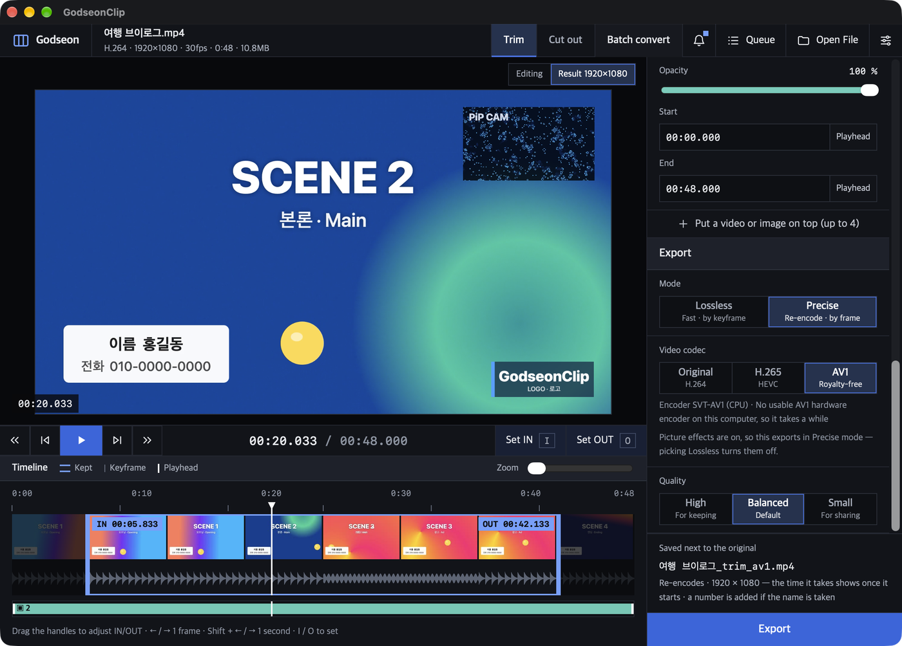

GodseonClip is a desktop app that **trims video losslessly in seconds** or **cuts it frame-accurately and shrinks it to H.265 · AV1** (Precise). Picture effects (crop · rotate · output size · mosaic · blur · picture in picture), batch conversion with estimated sizes, and a job queue all live in one window. It never overwrites the original file.

- Tauri 2 + React 19 / TypeScript + Rust
- Video is processed by **the FFmpeg 6.0+ you install** (not bundled — see [below](#before-you-start-install-ffmpeg))
- UI in Korean and English

> **Status:** built and verified on macOS (Apple Silicon). Installers are on [Releases](../../releases) — GitHub Actions builds all three OSes for every `v*` tag (Windows signed by SignPath Foundation, macOS not notarized yet). Windows and Ubuntu are not verified on real machines yet, and auto-update is the next phase.
>
> The screenshots below show the Korean UI except the one above; button names are given in English in the text. The videos and logo in them are synthetic demo clips.

## Contents

- [Features at a glance](#features-at-a-glance)
- [Before you start: install FFmpeg](#before-you-start-install-ffmpeg)
- [Build · run](#build--run)
- [How to use](#how-to-use)
  - [1. Open a file](#1-open-a-file)
  - [2. Trim](#2-trim)
  - [3. Cut out](#3-cut-out)
  - [4. Picture effects — crop · rotate · output size](#4-picture-effects--crop--rotate--output-size)
  - [5. Mosaic · blur](#5-mosaic--blur)
  - [6. Picture in picture · logo](#6-picture-in-picture--logo)
  - [7. Batch convert + estimated size](#7-batch-convert--estimated-size)
  - [8. Queue · notifications](#8-queue--notifications)
  - [9. FFmpeg settings](#9-ffmpeg-settings)
  - [10. Korean / English](#10-korean--english)
- [Keyboard shortcuts](#keyboard-shortcuts)
- [Originals and output files](#originals-and-output-files)
- [Development](#development)
- [Code signing policy](#code-signing-policy)
- [License](#license)

## Features at a glance

| Feature | What it does |
|---|---|
| Trim | Keep one part (IN / OUT). Lossless copies streams in seconds at keyframes; Precise re-encodes frame-accurately |
| Cut out | Mark several parts to remove and join the rest (drop ads, mistakes) |
| Codecs | Original (stream copy) · H.265 · AV1, quality presets High / Balanced / Small |
| Hardware encoding | VideoToolbox (macOS) · NVENC · QSV · AMF (Windows) · VAAPI (Linux), falls back to a CPU encoder on failure |
| Picture effects | Crop (fixed ratios) · 90° rotation · mirror / upside down · output size (1080p · 720p · 480p · custom) |
| Mosaic · blur | Up to 20 boxes, each with its kind · strength · time range |
| Picture in picture · logo | Up to 4 videos or images (PNG transparency too): position · size · opacity · time · mixed sound |
| Batch convert | Files and folders (with subfolders) to H.265 / AV1 at once, with estimated sizes and savings first |
| Queue | Exports and conversions all go to one queue, 1–4 parallel jobs, reorder · cancel · restart · FFmpeg log |
| Preview | Thumbnail · waveform · keyframe timeline; files the web view can't play (MKV on macOS…) get a 540p proxy automatically |

## Before you start: install FFmpeg

GodseonClip **does not ship FFmpeg.** This keeps GPL encoders such as x265 and HEVC patent terms out of the app's distribution. Instead it finds the `ffmpeg` · `ffprobe` installed on your computer (6.0 or newer — libavcodec 60+). If none usable is found at first start, the app opens on its settings screen with install instructions.

| OS | Install command |
|---|---|
| macOS | `brew install ffmpeg` (install [Homebrew](https://brew.sh) first if you don't have it) |
| Windows | `winget install --id Gyan.FFmpeg -e` (or `scoop install ffmpeg`, `choco install ffmpeg`) |
| Ubuntu 24.04 | `sudo apt install ffmpeg` |
| Ubuntu 22.04 | The apt version (4.4) is too old → get the linux64-gpl build from [BtbN/FFmpeg-Builds](https://github.com/BtbN/FFmpeg-Builds/releases) and pick `bin/ffmpeg` with “Set the Path Yourself” in the app settings |

- macOS: an app opened from Finder doesn't know the terminal's PATH, so `/opt/homebrew/bin` (Apple Silicon) and `/usr/local/bin` (Intel) are checked directly. Hardware encoding is H.265 only; AV1 runs on the CPU (SVT-AV1).
- Windows: NVENC · QSV · AMF need an up-to-date graphics driver. AV1 hardware encoding needs an RTX 40 · Intel Arc · Radeon RX 7000 or newer GPU.
- Ubuntu: for hardware encoding (optional) install `intel-media-va-driver-non-free` (Intel) or `mesa-va-drivers` (AMD).

## Build · run

### Installers

Download the file for your OS from [Releases](../../releases). [Install FFmpeg](#before-you-start-install-ffmpeg) first.

| OS | File | Install |
|---|---|---|
| macOS (Apple Silicon · Intel) | `GodseonClip-<version>-macos-universal.dmg` | Open it and drag the app to Applications. It isn't notarized yet: if the first launch is blocked, use System Settings › Privacy & Security › **Open Anyway** (or `xattr -dr com.apple.quarantine /Applications/GodseonClip.app`) |
| Windows 10 / 11 (x64) | `GodseonClip-<version>-windows-setup.exe` · `-windows-portable.zip` | The installer needs no admin rights and installs into your user folder (`%LOCALAPPDATA%\Programs\GodseonClip`); it installs the WebView2 Runtime if missing. The portable zip just unpacks and runs |
| Ubuntu 22.04 / 24.04 (x64) | `GodseonClip-<version>-linux-amd64.deb` · `.AppImage` | `sudo apt install ./GodseonClip-*.deb` |

Windows files are signed with a SignPath Foundation certificate — check that `GodseonClip.exe` › Properties › **Digital Signatures** lists 'SignPath Foundation' ([Code signing policy](#code-signing-policy)). For an unsigned build, SmartScreen needs **More info** → **Run anyway**.

### Build from source

**You need:** [Node.js](https://nodejs.org) 24 (the TS tests use Node's built-in type stripping) · [Rust](https://rustup.rs) stable · the [Tauri 2 prerequisites](https://tauri.app/start/prerequisites/) (Xcode Command Line Tools on macOS, WebView2 · MSVC on Windows, webkit2gtk etc. on Ubuntu) · FFmpeg 6.0+

```bash
npm install
npm run tauri dev                              # run in development mode (the first run builds Rust for a few minutes)
npm run tauri build                            # release build (src-tauri/target/release/bundle/)
npm run tauri build -- --debug --bundles app   # quick macOS debug .app only
```

## How to use

The header at the top switches between **Trim · Cut out · Batch convert · Notifications · Queue · Open File · Settings**.

### 1. Open a file

Click **Open File** in the header, or drop a video from Finder or Explorer onto the window. Anything FFmpeg reads works — MP4 · MOV · MKV · WebM and more.

- The timeline under the player shows **thumbnails · audio waveform · keyframes**. Widen it with the Zoom slider.
- Files the web view can't play directly (MKV on macOS and so on) get a 540p proxy for playback automatically. Exports always use the original.

### 2. Trim

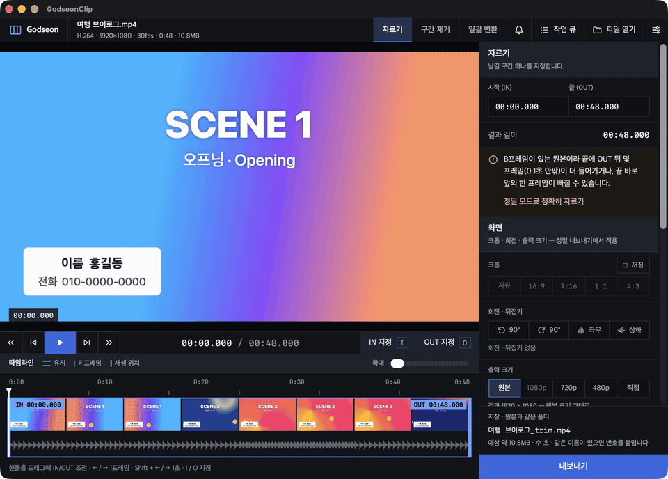

1. Click the timeline or play, and press <kbd>I</kbd> where the part to keep starts and <kbd>O</kbd> where it ends. You can also drag the IN · OUT handles on the timeline or type times in the panel. <kbd>←</kbd> <kbd>→</kbd> move one frame, <kbd>Shift</kbd>+<kbd>←</kbd> <kbd>→</kbd> one second.
2. Pick a mode under **Export** in the right panel.
   - **Lossless** — copies the streams without re-encoding. Even 4K × 10 minutes takes about a second, but the start snaps to a keyframe. MP4 · MOV get an edit list so playback starts at the IN frame.
   - **Precise** — cuts exactly from the IN frame to the frame just before OUT, and re-encodes.
3. Video codec: **Original** (stream copy) · **H.265** · **AV1**. Choosing H.265 · AV1 or turning on a picture effect switches the mode to Precise. Quality is **High** (for keeping) · **Balanced** (default) · **Small** (for sharing) — values tuned with VMAF so every encoder gives the same quality.
4. **Export** adds a job to the queue, and you can open another file right away. The result is saved next to the original as `name_trim_h265.mp4` and so on.

### 3. Cut out

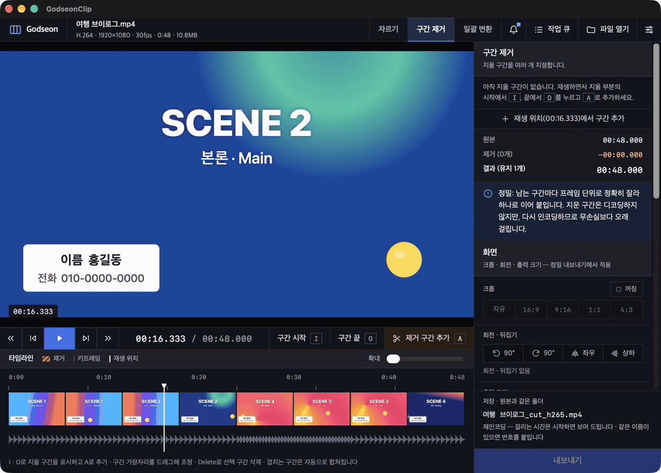

Choose **Cut out** in the header to mark several parts to remove.

1. Press <kbd>I</kbd> where a part to remove starts, <kbd>O</kbd> where it ends, then <kbd>A</kbd> to add it (or the add button in the panel). Parts to remove are hatched on the timeline.
2. Drag a part's edges on the timeline to adjust it. Pick a part in the panel list to jump to its start, and press <kbd>Delete</kbd> to remove it. Overlapping parts are merged automatically.
3. The summary under the list shows original · removed · result lengths. A Precise export cuts every kept part frame-accurately and joins them. Lossless works too, but a short part with no keyframe inside can't be removed, and kept parts may start at the keyframe before — the panel tells you the difference beforehand.

### 4. Picture effects — crop · rotate · output size

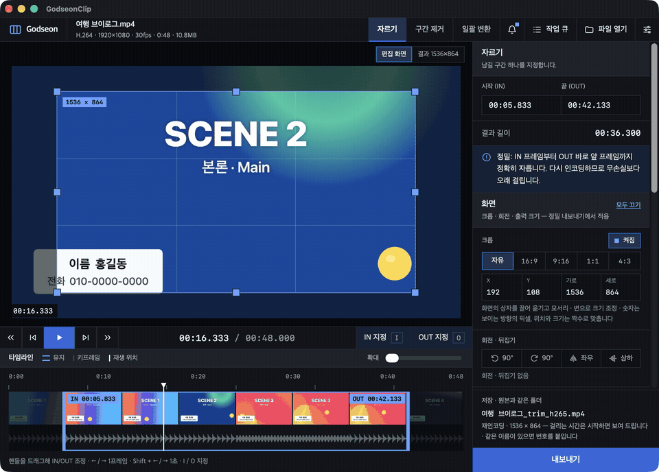

The **Picture** section of the panel. Turning on an effect switches the export to Precise (picking Lossless turns effects off; the box you drew is remembered).

- **Crop** — turning it on puts a box on the picture. Drag the box to move it and its corner · edge handles to resize. Ratios: Free · 16:9 · 9:16 · 1:1 · 4:3, or type X · Y · Width · Height (kept even).
- **Rotate · flip** — 90° left / right, Mirror, Upside down.
- **Output size** — Original · 1080p · 720p · 480p (short side, never enlarged) or Custom W × H with Fit (black bars) / Fill (edges cut) / Stretch.
- The **Editing / Result** buttons at the top right of the stage preview exactly what will be exported.

### 5. Mosaic · blur

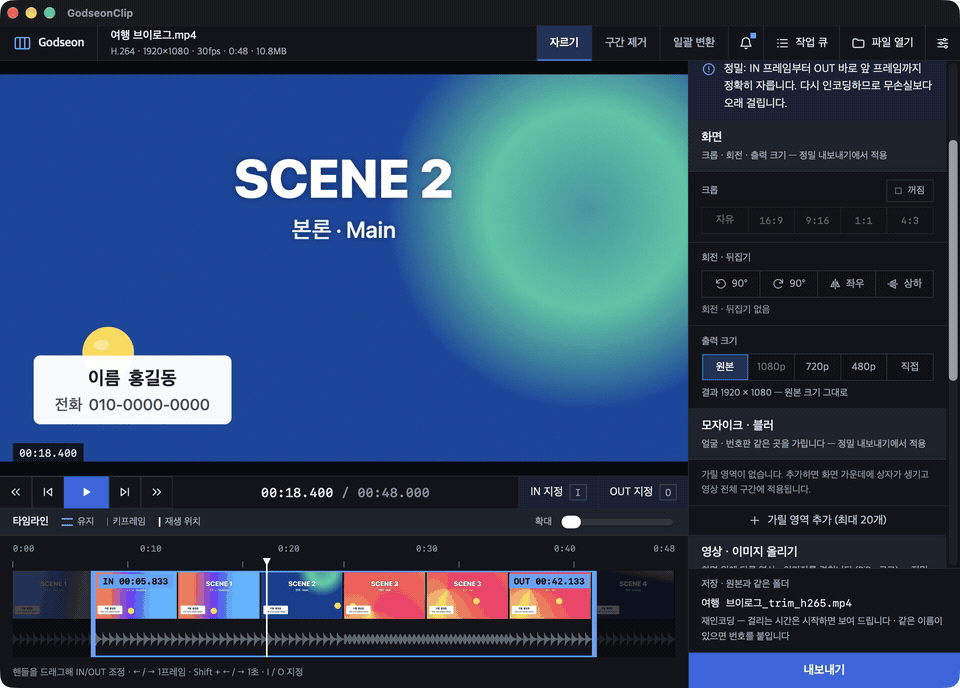

For faces, license plates, personal details and anything else to hide.

1. **Add a box to hide** puts a box in the middle of the picture (up to 20). Drag it into place and resize it with the handles.
2. Pick each box's kind (**Mosaic** squares / **Blur** soft) and **Strength** (1–100, relative to the picture's short side so it looks the same at any resolution).
3. **Start · End** hide it only in that range. Use the panel's “Playhead” buttons, or drag the ends on the timeline's **Hide** lane. Trimming or cutting out keeps the boxes on the right result times.

The editing view previews it close to the real result.

### 6. Picture in picture · logo

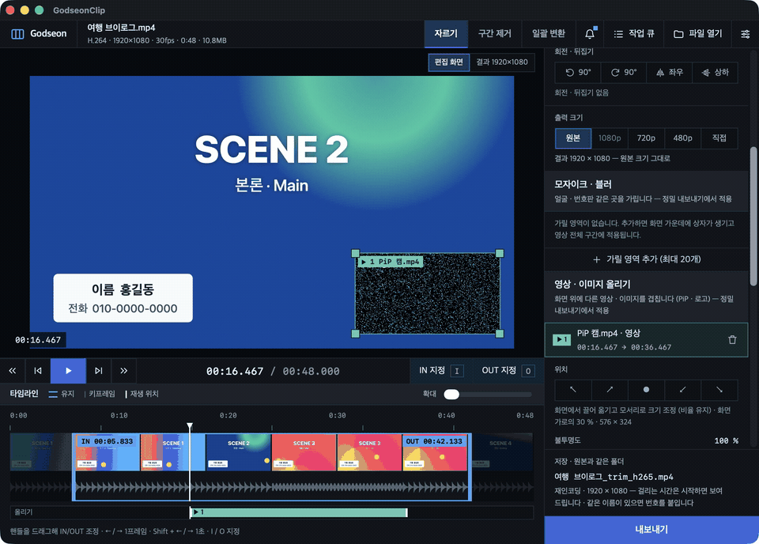

Lay up to 4 other videos (picture in picture) or images (logo · watermark, PNG transparency too) over the picture.

1. **Put a video or image on top** and pick a file; it lands at the bottom right.
2. Move it with the five **Position** presets (↖ ↗ ● ↙ ↘) or by dragging, and resize it from a corner (its own ratio is kept). Set its **Opacity**.
3. Set **Start · End** and, for a video, where in it to start. A video shorter than its range disappears when it ends. It can also be dragged on the timeline's **On top** lane.
4. A video's sound is off by default; **Mix its sound** adds it at the chosen **Volume** for that range only.
5. Overlays stay upright in the result even when the picture is rotated or flipped.

### 7. Batch convert + estimated size

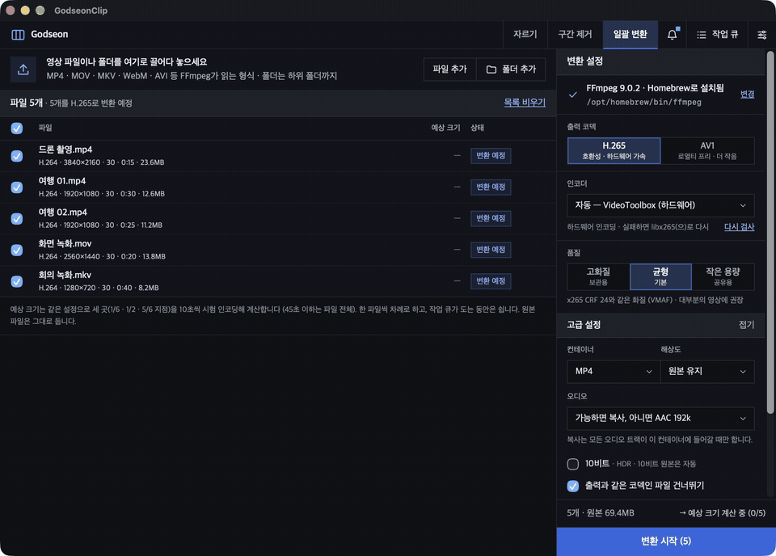

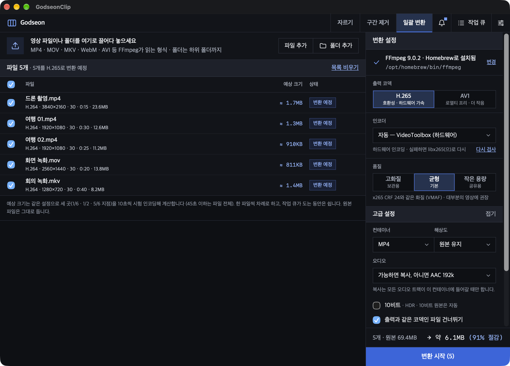

**Batch convert** in the header shrinks many files to H.265 / AV1 at once.

1. **Add Files · Add Folders**, or drop them. Folders are searched for videos including subfolders (up to 1000).
2. Set things up on the right: output codec (H.265 / AV1) · encoder (Auto = hardware first, CPU if it fails · or a specific one) · quality · container (MP4 · MKV · MOV for H.265, MP4 · MKV · WebM for AV1) · resolution (scale down to 1080 / 720 short side) · audio · 10-bit · skip files already in the output codec · save location · name ending (`_h265` · `_av1` by default).
3. The **Est. size** column fills in file by file: three 10-second parts (at 1/6 · 1/2 · 5/6) are test-encoded with the same settings (the whole file if it's 45 s or shorter), and the total below shows the savings. Tests pause while the queue runs and run again when settings change.
4. **Start Converting** makes one queue job per file, and each row's status follows its job.

### 8. Queue · notifications

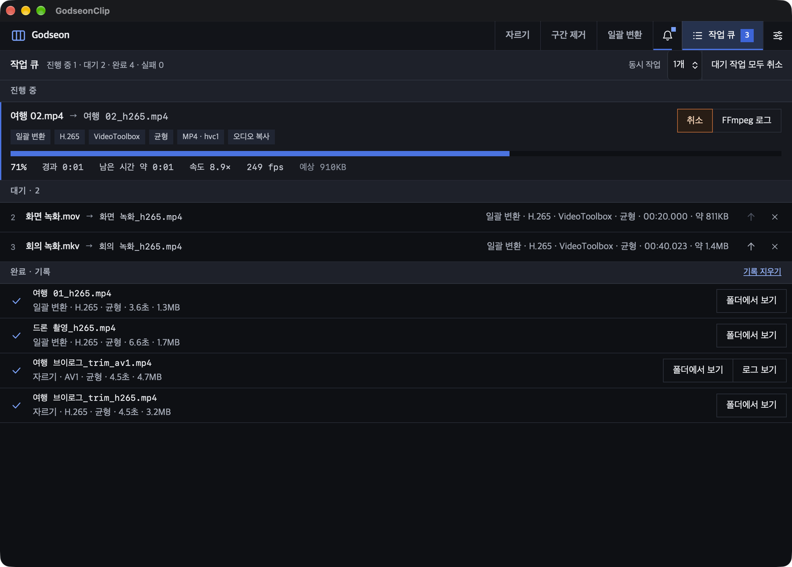

Editor exports and batch conversions all go to the **Queue**.

- Running card: progress · elapsed · time left · speed · fps · estimated size, **Cancel**, **FFmpeg Log**.
- Waiting list: ↑ moves a job up, × removes it, **Cancel All Waiting**. **Parallel jobs** 1–4 (kept for the next start).
- Done · History: **Show in Folder**; failed or canceled jobs can **Restart** (failed ones also show their log).
- Quitting with running or waiting jobs asks first; quitting cancels them all and cleans up temporary files.

The bell in the header is **Notifications** — running, waiting and just-finished jobs from any screen.

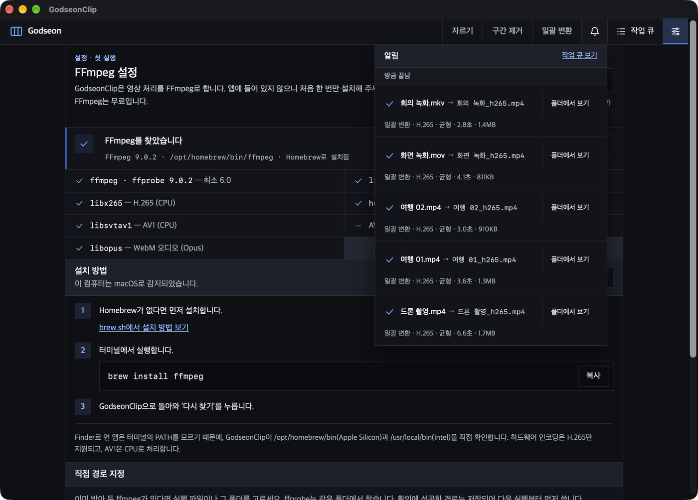

### 9. FFmpeg settings

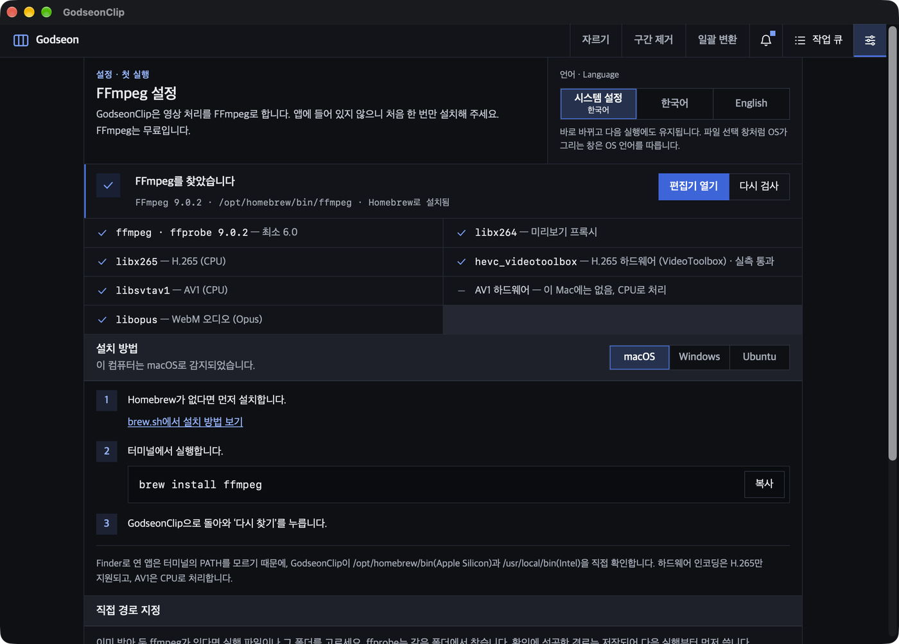

The settings button at the right end of the header.

- The FFmpeg found: version · location · how it was installed, and features (libx264 · libx265 · SVT-AV1 · Opus · hardware encoders actually tested).
- Install steps per OS (macOS · Windows · Ubuntu tabs) with copy buttons, and **Check Again**.
- **Set the Path Yourself** — pick an ffmpeg you already have; once it checks out it's saved and tried first from the next start. If it disappears or drops below 6.0, the app goes back to searching automatically and tells you.
- **Diagnostics** at the bottom is a developer check screen (file info · playback support · encoders · lossless trim).

### 10. Korean / English

Pick System · 한국어 · English under **언어 · Language** at the top of the settings screen. It changes at once without a restart — even error messages already on screen switch language. The default follows the OS language (English unless Korean comes first).

## Keyboard shortcuts

In the editor (when no text field has focus):

| Key | Action |
|---|---|
| <kbd>Space</kbd> | Play / pause |
| <kbd>←</kbd> / <kbd>→</kbd> | One frame back / forward |
| <kbd>Shift</kbd>+<kbd>←</kbd> / <kbd>→</kbd> | One second back / forward |
| <kbd>I</kbd> / <kbd>O</kbd> | Set IN / OUT (in Cut out: start / end of a part to remove) |
| <kbd>A</kbd> | Add the marked part as a part to remove (Cut out) |
| <kbd>Delete</kbd> / <kbd>Backspace</kbd> | Delete the selected part to remove (Cut out) |

They also work with a non-Latin keyboard layout active (the key in the same place).

## Originals and output files

- The original file is **never overwritten.** Results are written as `name.part.ext` and renamed only on success; failed or canceled jobs delete the `.part`.
- If the name is taken, a number such as `(1)` · `(2)` is added.
- H.265 in MP4 · MOV is tagged `hvc1` so Apple devices play it.

## Development

```bash
npm run test:rust     # Rust unit tests (no FFmpeg needed)
npm run test:ts       # TS pure-function tests (Node's built-in runner)
npm run build         # TypeScript check + front-end build
npm run test:ffmpeg   # integration tests that need a real FFmpeg 6.0+
```

Integration tests with another FFmpeg: `GODSEON_FFMPEG=/path/to/ffmpeg npm run test:ffmpeg`

| Path | Role |
|---|---|
| `src/App.tsx` | App shell — editor · batch convert · queue · FFmpeg settings · diagnostics |
| `src/features/editor/` | Editor (player · timeline · trim · cut out · picture effects · mosaic · PiP · export) |
| `src/features/convert/` · `queue/` · `setup/` · `notify/` | Batch convert · queue · FFmpeg settings · notifications |
| `src/lib/i18n/` | Korean / English dictionaries |
| `src-tauri/src/plan.rs` | Keep list — the shared model behind trim and cut out |
| `src-tauri/src/effects.rs` | Picture effect layer (crop · rotate · size · mosaic · PiP) |
| `src-tauri/src/command.rs` | The only place FFmpeg arguments are built (argument arrays, no shell) |
| `src-tauri/src/queue.rs` · `jobs.rs` | Queue · running · progress · cancel · `.part` handling |

Progress, decisions and known gaps are in [docs/PROGRESS.md](docs/PROGRESS.md) (Korean).

## Code signing policy

Windows release files (`GodseonClip.exe`, the installer and the uninstaller) are code-signed with a SignPath Foundation certificate.
Free code signing provided by [SignPath.io](https://about.signpath.io), certificate by [SignPath Foundation](https://signpath.org).

- Only files that GitHub Actions builds from this repository's source are signed, and an approver approves each release's signing request by hand.
- Committers and reviewers: [afy0817](https://github.com/afy0817)
- Approvers: [afy0817](https://github.com/afy0817)
- Privacy: GodseonClip sends no information over the network — [Privacy policy](PRIVACY.md).

## License

[MIT](LICENSE). Open source components included: [Tauri](https://tauri.app) (MIT / Apache-2.0), [React](https://react.dev) (MIT), and other Rust · npm dependencies (MIT / Apache-2.0 and similar — `src-tauri/Cargo.lock`, `package-lock.json`).

FFmpeg is not included in GodseonClip and has its own licenses (LGPL / GPL). Patent terms for H.265 (HEVC) output are for the user to check.
