<p align="center">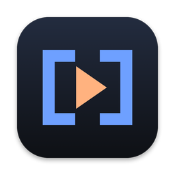</p>

<h1 align="center">GodseonClip</h1>

<p align="center">맥 · 윈도우 · 우분투에서 쓰는 영상 자르기 · 구간 제거 · H.265 / AV1 변환기</p>

<p align="center"><b>한국어</b> · <a href="README.en.md">English</a></p>

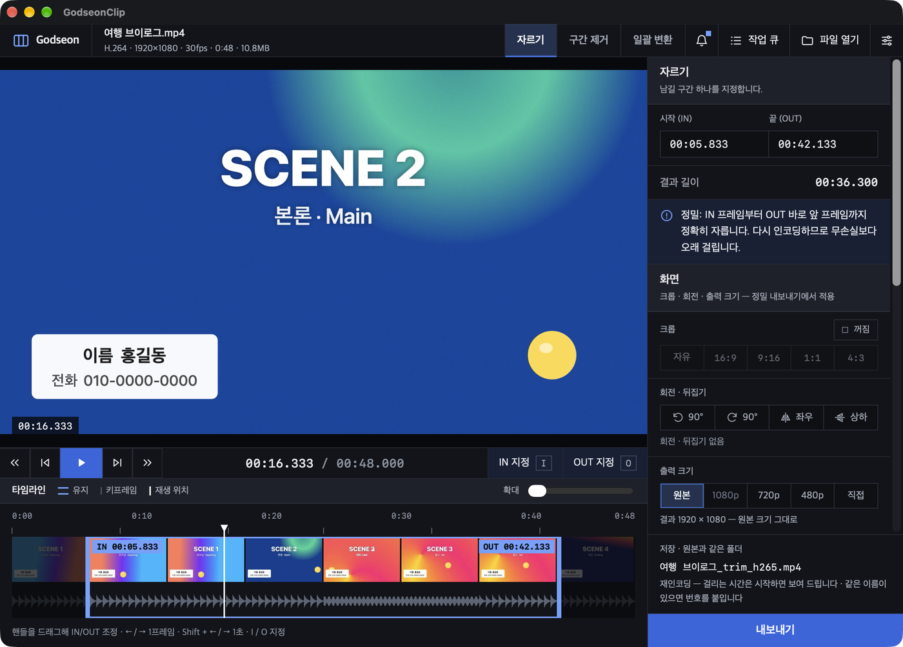

GodseonClip은 영상을 **원본 그대로 빠르게 자르거나**(무손실), **프레임 단위로 정확히 잘라 H.265 · AV1로 줄이는**(정밀) 데스크톱 앱입니다. 크롭 · 회전 · 출력 크기 · 모자이크 · 블러 · PiP 같은 화면 효과, 폴더째 넣는 일괄 변환과 예상 크기, 작업 큐까지 한 창에서 합니다. 원본 파일은 절대 덮어쓰지 않습니다.

- Tauri 2 + React 19 / TypeScript + Rust
- 영상 처리는 **사용자가 설치한 FFmpeg 6.0 이상**으로 합니다 (앱에 넣지 않음 — [아래](#준비-ffmpeg-설치))
- 화면은 한국어 / 영어

> **지금 상태:** macOS(Apple Silicon)에서 만들고 검증했습니다. 설치 파일은 [Releases](../../releases)에서 받습니다 — `v*` 태그마다 GitHub Actions가 세 OS를 빌드합니다 (Windows는 SignPath Foundation 서명, macOS는 아직 공증 전). Windows · Ubuntu는 실기기 검증 전이고, 자동 업데이트는 다음 단계입니다.
>
> 아래 화면의 영상 · 로고는 설명용으로 합성한 데모 클립입니다.

## 목차

- [기능 한눈에](#기능-한눈에)
- [준비: FFmpeg 설치](#준비-ffmpeg-설치)
- [설치 · 실행](#설치--실행)
- [사용법](#사용법)
  - [1. 파일 열기](#1-파일-열기)
  - [2. 자르기](#2-자르기)
  - [3. 구간 제거](#3-구간-제거)
  - [4. 화면 효과 — 크롭 · 회전 · 출력 크기](#4-화면-효과--크롭--회전--출력-크기)
  - [5. 모자이크 · 블러](#5-모자이크--블러)
  - [6. 영상 · 이미지 올리기 (PiP · 로고)](#6-영상--이미지-올리기-pip--로고)
  - [7. 일괄 변환 + 예상 크기](#7-일괄-변환--예상-크기)
  - [8. 작업 큐 · 알림](#8-작업-큐--알림)
  - [9. FFmpeg 설정](#9-ffmpeg-설정)
  - [10. 한국어 / English](#10-한국어--english)
- [단축키](#단축키)
- [원본과 결과 파일](#원본과-결과-파일)
- [개발](#개발)
- [Code signing policy](#code-signing-policy)
- [라이선스](#라이선스)

## 기능 한눈에

| 기능 | 하는 일 |
|---|---|
| 자르기 | 남길 구간 하나(IN / OUT). 무손실은 키프레임 단위로 몇 초 만에, 정밀은 프레임 단위로 다시 인코딩 |
| 구간 제거 | 지울 구간을 여러 개 골라 나머지를 하나로 이어 붙임 (광고 · 실수 장면 빼기) |
| 코덱 | 원본 유지(스트림 복사) · H.265 · AV1, 품질 프리셋 고화질 / 균형 / 작은 용량 |
| 하드웨어 인코딩 | VideoToolbox (macOS) · NVENC · QSV · AMF (Windows) · VAAPI (Linux), 실패하면 CPU 인코더로 다시 |
| 화면 효과 | 크롭(비율 고정) · 90° 회전 · 좌우 / 상하 뒤집기 · 출력 크기(1080p · 720p · 480p · 직접) |
| 모자이크 · 블러 | 사각형 영역 최대 20개, 영역마다 종류 · 강도 · 시간 구간 |
| PiP · 로고 | 영상 · 이미지(PNG 투명 포함) 최대 4개, 위치 · 크기 · 불투명도 · 시간 · 소리 섞기 |
| 일괄 변환 | 파일 · 폴더(하위 폴더까지)를 한 번에 H.265 / AV1로, 변환 전에 예상 크기 · 절감률 |
| 작업 큐 | 내보내기 · 변환이 모두 큐에 쌓임, 동시 작업 1~4개, 순서 · 취소 · 다시 시작 · FFmpeg 로그 |
| 미리보기 | 썸네일 · 파형 · 키프레임 타임라인, 웹뷰가 못 여는 MKV 등은 540p 프록시를 자동으로 만들어 재생 |

## 준비: FFmpeg 설치

GodseonClip은 FFmpeg를 **앱에 넣어 배포하지 않습니다.** x265 같은 GPL 인코더와 HEVC 특허 조건을 앱 배포에 끌어들이지 않으려고 정한 정책입니다. 대신 컴퓨터에 설치된 `ffmpeg` · `ffprobe`(6.0 이상 — libavcodec 60+)를 찾아 씁니다. 처음 켰을 때 쓸 수 있는 FFmpeg가 없으면 앱이 설정 화면으로 시작해 설치 방법을 보여 줍니다.

| OS | 설치 명령 |
|---|---|
| macOS | `brew install ffmpeg` ([Homebrew](https://brew.sh)가 없다면 먼저 설치) |
| Windows | `winget install --id Gyan.FFmpeg -e` (Scoop이면 `scoop install ffmpeg`, Chocolatey면 `choco install ffmpeg`) |
| Ubuntu 24.04 | `sudo apt install ffmpeg` |
| Ubuntu 22.04 | apt 버전(4.4)은 너무 오래됨 → [BtbN/FFmpeg-Builds](https://github.com/BtbN/FFmpeg-Builds/releases)의 linux64-gpl 빌드를 받아 앱 설정의 ‘직접 경로 지정’에서 `bin/ffmpeg`를 고름 |

- macOS: Finder로 연 앱은 터미널의 PATH를 모르므로 `/opt/homebrew/bin`(Apple Silicon) · `/usr/local/bin`(Intel)을 직접 확인합니다. 하드웨어 인코딩은 H.265만 되고 AV1은 CPU(SVT-AV1)로 합니다.
- Windows: NVENC · QSV · AMF에는 최신 그래픽 드라이버가 필요합니다. AV1 하드웨어 인코딩은 RTX 40 · Intel Arc · Radeon RX 7000 이후 GPU에서만 됩니다.
- Ubuntu: 하드웨어 인코딩(선택)은 Intel `intel-media-va-driver-non-free`, AMD `mesa-va-drivers`.

## 설치 · 실행

### 설치 파일

[Releases](../../releases)에서 OS에 맞는 파일을 받습니다. 먼저 [FFmpeg를 설치](#준비-ffmpeg-설치)해 두세요.

| OS | 파일 | 설치 |
|---|---|---|
| macOS (Apple Silicon · Intel) | `GodseonClip-<버전>-macos-universal.dmg` | 열어서 Applications로 끌기. 아직 공증 전이라 처음 열 때 막히면 시스템 설정 › 개인정보 보호 및 보안 › **그래도 열기** (또는 `xattr -dr com.apple.quarantine /Applications/GodseonClip.app`) |
| Windows 10 / 11 (x64) | `GodseonClip-<버전>-windows-setup.exe` · `-windows-portable.zip` | 설치 파일은 관리자 권한 없이 사용자 폴더(`%LOCALAPPDATA%\Programs\GodseonClip`)에 설치하고, WebView2 런타임이 없으면 받아서 설치합니다. 휴대용은 압축만 풀어 실행 |
| Ubuntu 22.04 / 24.04 (x64) | `GodseonClip-<버전>-linux-amd64.deb` · `.AppImage` | `sudo apt install ./GodseonClip-*.deb` |

Windows 파일은 SignPath Foundation 인증서로 서명합니다 — `GodseonClip.exe` 속성 › **디지털 서명**에 'SignPath Foundation'이 있는지로 확인합니다 ([Code signing policy](#code-signing-policy)). 서명이 없는 빌드는 SmartScreen에서 **추가 정보** → **실행**.

### 소스에서 빌드

**필요한 것:** [Node.js](https://nodejs.org) 24 (TS 테스트가 Node 내장 타입 제거를 씀) · [Rust](https://rustup.rs) stable · [Tauri 2 사전 요구 사항](https://tauri.app/start/prerequisites/) (macOS는 Xcode Command Line Tools, Windows는 WebView2 · MSVC, Ubuntu는 webkit2gtk 등) · FFmpeg 6.0+

```bash
npm install
npm run tauri dev                          # 개발 모드로 실행 (첫 실행은 Rust 빌드로 몇 분)
npm run tauri build                        # 배포용 빌드 (src-tauri/target/release/bundle/)
npm run tauri build -- --debug --bundles app   # macOS 디버그 .app만 빠르게
```

## 사용법

화면 위쪽 헤더에서 **자르기 · 구간 제거 · 일괄 변환 · 알림 · 작업 큐 · 파일 열기 · 설정**으로 옮겨 다닙니다.

### 1. 파일 열기

헤더의 **파일 열기**를 누르거나 Finder · 탐색기에서 영상을 창으로 끌어다 놓습니다. MP4 · MOV · MKV · WebM 등 FFmpeg가 읽는 형식이면 됩니다.

- 열면 플레이어 아래 타임라인에 **썸네일 · 오디오 파형 · 키프레임**이 그려집니다. 확대 슬라이더로 넓혀 볼 수 있습니다.
- 웹뷰가 바로 재생하지 못하는 파일(macOS의 MKV 등)은 540p 프록시를 자동으로 만들어 재생합니다. 내보낼 때는 언제나 원본을 씁니다.

### 2. 자르기

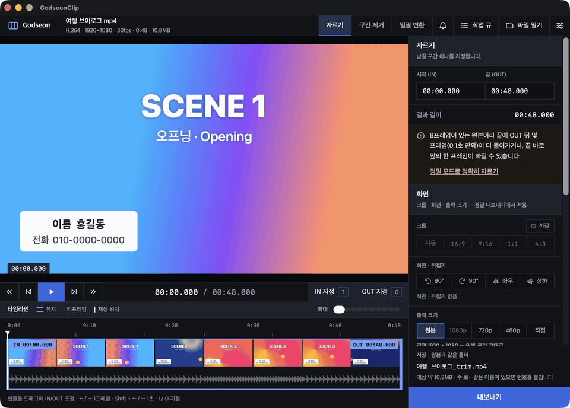

1. 타임라인을 클릭하거나 재생하다가 남길 부분의 시작에서 <kbd>I</kbd>, 끝에서 <kbd>O</kbd>를 누릅니다. 타임라인의 IN · OUT 핸들을 끌거나 오른쪽 칸에 시각을 직접 입력해도 됩니다. <kbd>←</kbd> <kbd>→</kbd>는 한 프레임, <kbd>Shift</kbd>+<kbd>←</kbd> <kbd>→</kbd>는 1초씩 움직입니다.
2. 오른쪽 패널 **내보내기**에서 방식을 고릅니다.
   - **무손실** — 다시 인코딩하지 않고 스트림을 복사합니다. 4K 10분짜리도 1초 안팎이지만 시작이 키프레임에 맞춰집니다. MP4 · MOV는 편집 목록으로 IN 프레임부터 재생되게 합니다.
   - **정밀** — IN 프레임부터 OUT 바로 앞 프레임까지 프레임 단위로 정확히 자르고 다시 인코딩합니다.
3. 비디오 코덱: **원본 유지**(스트림 복사) · **H.265** · **AV1**. H.265 · AV1을 고르거나 화면 효과를 켜면 방식이 정밀로 바뀝니다. 품질은 **고화질**(보관용) · **균형**(기본) · **작은 용량**(공유용) — 인코더가 달라도 같은 화질이 되도록 VMAF로 맞춘 값입니다.
4. **내보내기**를 누르면 작업 큐에 들어가고 바로 다른 파일을 열어도 됩니다. 결과는 원본과 같은 폴더에 `이름_trim_h265.mp4`처럼 저장됩니다.

### 3. 구간 제거

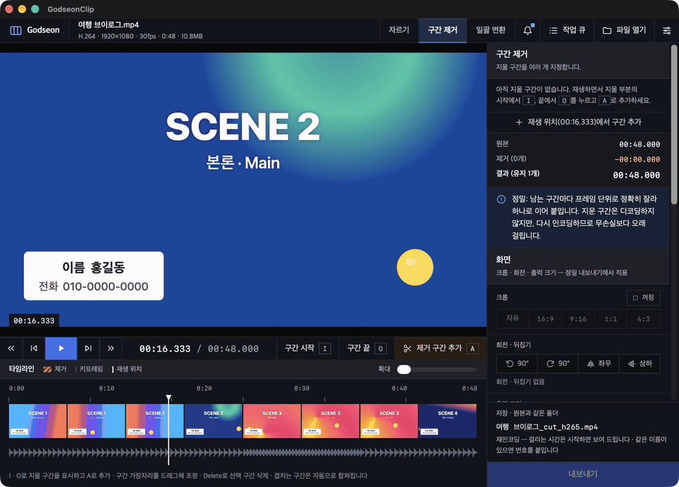

헤더에서 **구간 제거**를 고르면 지울 구간을 여러 개 지정할 수 있습니다.

1. 지울 부분의 시작에서 <kbd>I</kbd>, 끝에서 <kbd>O</kbd>를 누르고 <kbd>A</kbd>로 추가합니다 (패널의 ‘구간 추가’ 버튼도 같음). 지울 구간은 타임라인에 빗금으로 표시됩니다.
2. 타임라인에서 구간 가장자리를 끌어 조정합니다. 패널 목록에서 구간을 고르면 그 시작으로 이동하고, <kbd>Delete</kbd>로 지웁니다. 겹치는 구간은 자동으로 합쳐집니다.
3. 패널 아래 요약에 원본 · 제거 · 결과 길이가 나옵니다. 정밀로 내보내면 남는 구간마다 프레임 단위로 잘라 하나로 이어 붙입니다. 무손실로도 할 수 있지만, 안에 키프레임이 없는 짧은 구간은 지워지지 않고 남는 구간의 시작이 앞 키프레임으로 당겨질 수 있습니다 — 패널이 그 차이를 미리 알려 줍니다.

### 4. 화면 효과 — 크롭 · 회전 · 출력 크기

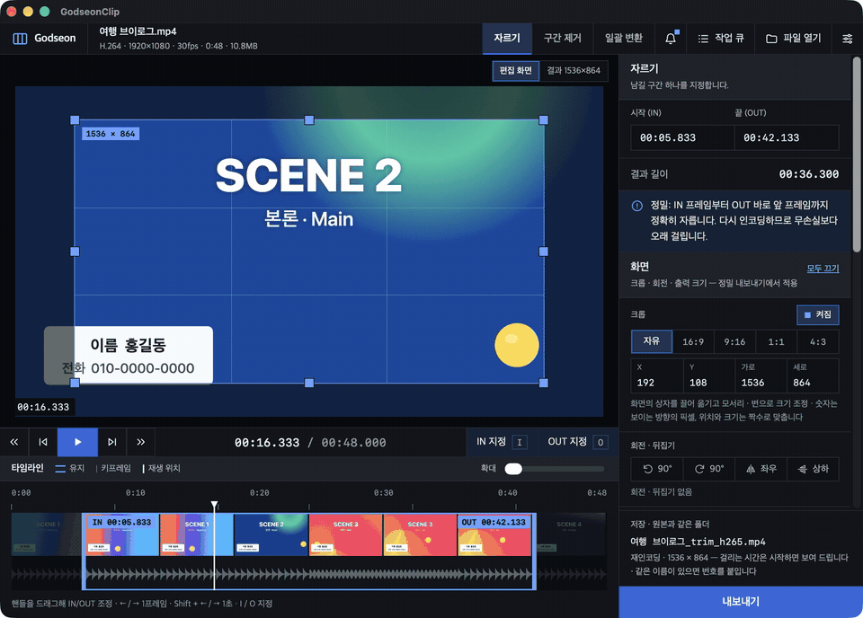

패널의 **화면** 섹션입니다. 효과를 켜면 내보내기 방식이 정밀로 바뀝니다 (무손실을 고르면 효과가 꺼지고, 그린 상자는 기억합니다).

- **크롭** — 켜면 화면에 상자가 생깁니다. 상자를 끌어 옮기고 모서리 · 변의 핸들로 크기를 바꿉니다. 비율은 자유 · 16:9 · 9:16 · 1:1 · 4:3, X · Y · 가로 · 세로를 숫자로 넣어도 됩니다 (짝수로 맞춤).
- **회전 · 뒤집기** — 90° 왼쪽 / 오른쪽, 좌우 · 상하 뒤집기.
- **출력 크기** — 원본 · 1080p · 720p · 480p(짧은 변 기준, 키우지 않음) 또는 직접 W × H + 맞춤(검은 여백) / 채움(가운데 잘림) / 늘림.
- 스테이지 오른쪽 위 **편집 화면 / 결과** 버튼으로 내보낼 결과를 그대로 미리 봅니다.

### 5. 모자이크 · 블러

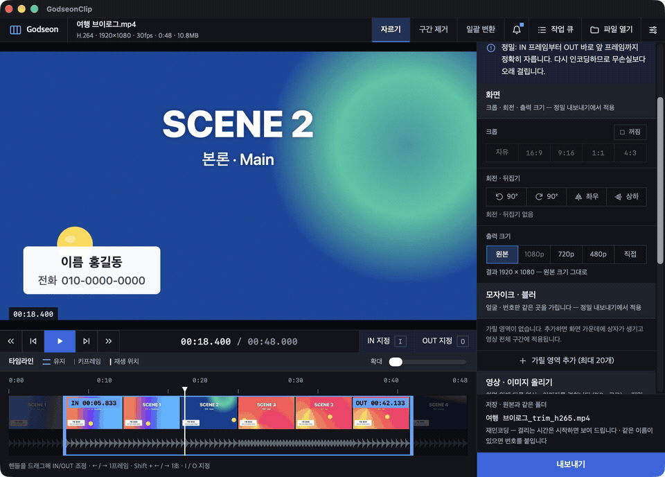

얼굴 · 번호판 · 개인 정보처럼 가릴 곳에 씁니다.

1. **가릴 영역 추가**를 누르면 화면 가운데 상자가 생깁니다 (최대 20개). 끌어서 옮기고 핸들로 크기를 맞춥니다.
2. 영역마다 종류(**모자이크** 네모 칸 / **블러** 부드럽게 흐림)와 **강도**(1–100, 화면 짧은 변 기준이라 해상도와 상관없이 같은 느낌)를 고릅니다.
3. **시작 · 끝**으로 그 구간에만 가립니다. 패널의 ‘재생 위치’ 버튼이나 타임라인의 **가리기** 줄에서 끝을 끌어 정합니다. 자르기 · 구간 제거를 해도 결과 시각에 맞춰 적용됩니다.

편집 화면에서도 실제와 비슷하게 미리 보입니다.

### 6. 영상 · 이미지 올리기 (PiP · 로고)

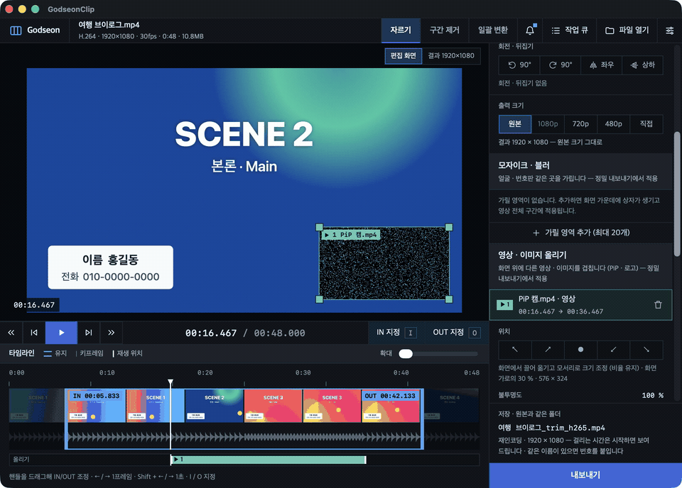

화면 위에 다른 영상(화면 속 화면)이나 이미지(로고 · 워터마크, PNG 투명 포함)를 최대 4개까지 겹칩니다.

1. **영상 · 이미지 올리기**로 파일을 고르면 오른쪽 아래에 놓입니다.
2. **위치** 프리셋 다섯(↖ ↗ ● ↙ ↘)으로 옮기거나 끌어서 옮기고, 모서리로 크기를 바꿉니다 (자기 비율 유지). **불투명도**도 조절합니다.
3. **시작 · 끝**과 올린 영상의 **쓸 부분 시작**을 정합니다. 올린 영상이 구간보다 짧으면 끝나고 사라집니다. 타임라인의 **올리기** 줄에서도 끌 수 있습니다.
4. 올린 영상의 소리는 기본으로 꺼져 있고, **소리 섞기**를 켜면 그 구간에만 볼륨만큼 섞습니다.
5. 회전 · 뒤집기를 해도 올린 것은 결과 화면에서 똑바로 섭니다.

### 7. 일괄 변환 + 예상 크기

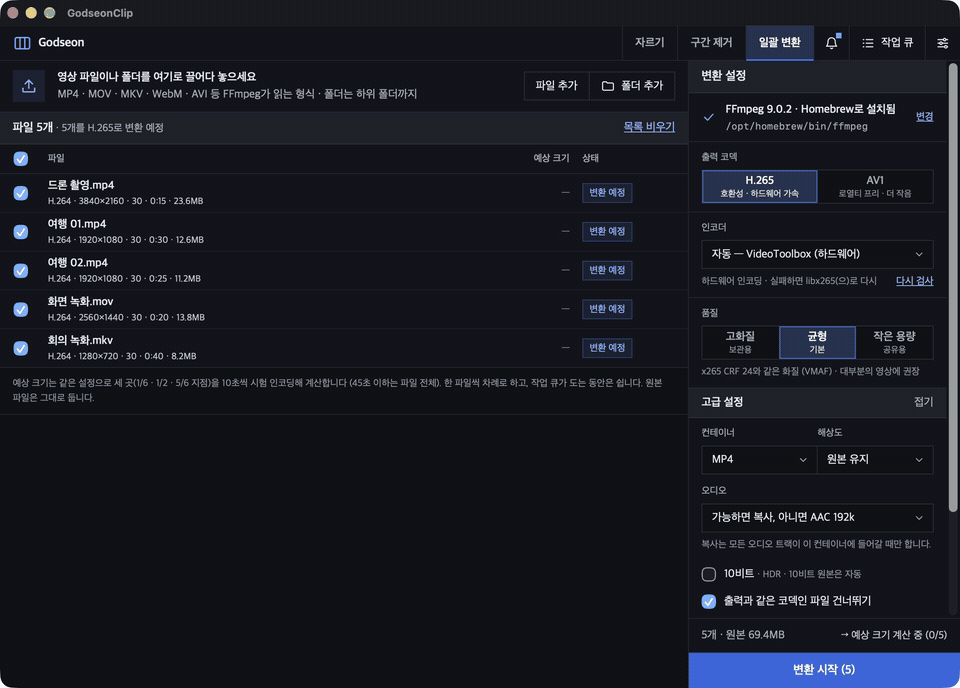

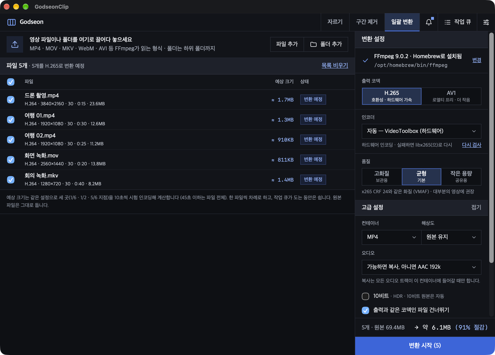

헤더의 **일괄 변환**에서 여러 파일을 한 번에 H.265 / AV1로 줄입니다.

1. **파일 추가 · 폴더 추가** 또는 끌어다 놓기. 폴더는 하위 폴더까지 영상 파일을 찾습니다 (최대 1000개).
2. 오른쪽에서 설정합니다: 출력 코덱(H.265 / AV1) · 인코더(자동 = 하드웨어 우선, 실패하면 CPU · 또는 직접) · 품질 · 컨테이너(H.265는 MP4 · MKV · MOV, AV1은 MP4 · MKV · WebM) · 해상도 축소(짧은 변 1080 / 720) · 오디오 · 10비트 · 같은 코덱 건너뛰기 · 저장 위치 · 붙임말(기본 `_h265` · `_av1`).
3. **예상 크기** 열이 파일마다 채워집니다. 같은 설정으로 세 곳(1/6 · 1/2 · 5/6 지점)을 10초씩 시험 인코딩해 계산하고(45초 이하는 파일 전체), 아래 합계에 절감률이 나옵니다. 작업 큐가 돌 때는 쉬고, 설정을 바꾸면 다시 계산합니다.
4. **변환 시작**을 누르면 파일마다 작업 큐 항목이 되고, 목록의 상태 칸이 큐를 따라갑니다.

### 8. 작업 큐 · 알림

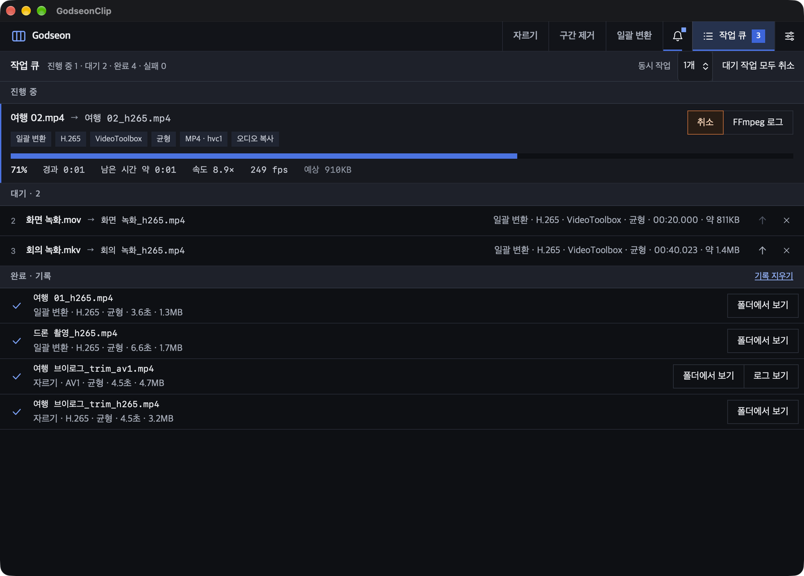

편집기 내보내기와 일괄 변환은 모두 **작업 큐**에 쌓입니다.

- 진행 중 카드: 진행률 · 경과 · 남은 시간 · 속도 · fps · 예상 크기, **취소**, **FFmpeg 로그**.
- 대기 목록: ↑로 순서 올리기, ×로 빼기, **대기 작업 모두 취소**. **동시 작업**은 1~4개(저장됨).
- 완료 · 기록: **폴더에서 보기**, 실패 · 취소한 항목은 **다시 시작**(실패하면 로그도 볼 수 있음).
- 진행 · 대기 작업이 있는데 앱을 끄면 확인 창이 뜨고, 끄면 모두 취소하고 임시 파일을 정리합니다.

헤더의 종 아이콘은 **알림**입니다 — 진행 · 대기 · 방금 끝난 작업을 어느 화면에서나 바로 봅니다.

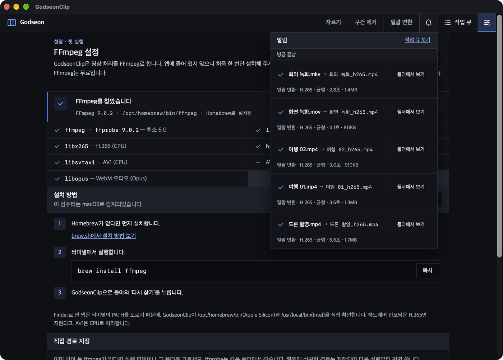

### 9. FFmpeg 설정

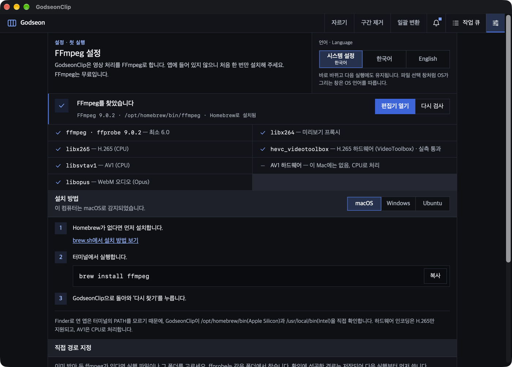

헤더 오른쪽 끝 설정 버튼입니다.

- 찾은 FFmpeg의 버전 · 위치 · 설치 경로, 기능 목록(libx264 · libx265 · SVT-AV1 · Opus · 하드웨어 인코더 실측 결과).
- OS별 설치 방법(macOS · Windows · Ubuntu 탭)과 복사 버튼, **다시 검사**.
- **직접 경로 지정** — 이미 받아 둔 ffmpeg를 고르면 확인 후 저장해 다음 실행부터 먼저 씁니다. 사라지거나 6.0보다 낮아지면 자동 탐색으로 돌아가며 알려 줍니다.
- 아래쪽 **진단**은 개발용 검증 화면(파일 정보 · 재생 호환 · 인코더 · 무손실 자르기 점검)입니다.

### 10. 한국어 / English

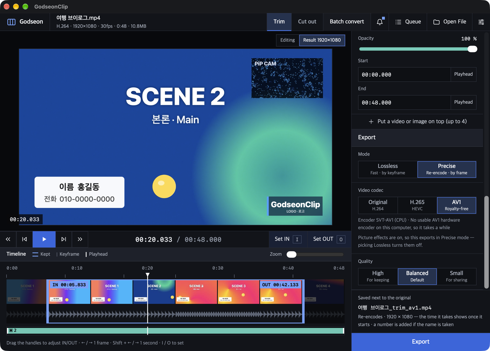

설정 화면 위쪽 **언어 · Language**에서 시스템 설정 · 한국어 · English를 고릅니다. 다시 켜지 않아도 바로 바뀌고, 이미 떠 있는 오류 문구까지 그 언어로 바뀝니다. 기본은 OS 언어(한국어가 아니면 영어)입니다.

## 단축키

편집기에서 (입력칸에 커서가 없을 때):

| 키 | 동작 |
|---|---|
| <kbd>Space</kbd> | 재생 / 일시 정지 |
| <kbd>←</kbd> / <kbd>→</kbd> | 한 프레임 뒤 / 앞 |
| <kbd>Shift</kbd>+<kbd>←</kbd> / <kbd>→</kbd> | 1초 뒤 / 앞 |
| <kbd>I</kbd> / <kbd>O</kbd> | IN / OUT 지정 (구간 제거에서는 지울 구간의 시작 / 끝) |
| <kbd>A</kbd> | 표시한 구간을 지울 구간으로 추가 (구간 제거) |
| <kbd>Delete</kbd> / <kbd>Backspace</kbd> | 고른 지울 구간 삭제 (구간 제거) |

한글 입력 상태에서도 같은 자리의 키로 동작합니다.

## 원본과 결과 파일

- 원본 파일은 **절대 덮어쓰지 않습니다.** 결과는 `이름.part.확장자`로 쓰고, 성공했을 때만 최종 이름으로 바꿉니다. 실패 · 취소하면 `.part`를 지웁니다.
- 같은 이름이 있으면 `(1)` · `(2)`처럼 번호를 붙입니다.
- H.265 MP4 · MOV는 Apple 기기 호환을 위해 `hvc1` 태그로 저장합니다.

## 개발

```bash
npm run test:rust     # Rust 단위 테스트 (FFmpeg 불필요)
npm run test:ts       # TS 순수 함수 테스트 (Node 내장 러너)
npm run build         # TypeScript 검사 + 프런트엔드 빌드
npm run test:ffmpeg   # 실제 FFmpeg 6.0+가 필요한 통합 테스트
```

다른 FFmpeg로 통합 테스트: `GODSEON_FFMPEG=/path/to/ffmpeg npm run test:ffmpeg`

| 경로 | 역할 |
|---|---|
| `src/App.tsx` | 앱 셸 — 편집기 · 일괄 변환 · 작업 큐 · FFmpeg 설정 · 진단 |
| `src/features/editor/` | 편집기 (플레이어 · 타임라인 · 자르기 · 구간 제거 · 화면 효과 · 모자이크 · PiP · 내보내기) |
| `src/features/convert/` · `queue/` · `setup/` · `notify/` | 일괄 변환 · 작업 큐 · FFmpeg 설정 · 알림 |
| `src/lib/i18n/` | 한국어 / 영어 사전 |
| `src-tauri/src/plan.rs` | 유지 구간 목록(keep list) — 자르기와 구간 제거의 공통 모델 |
| `src-tauri/src/effects.rs` | 화면 효과 층 (크롭 · 회전 · 크기 · 모자이크 · PiP) |
| `src-tauri/src/command.rs` | FFmpeg 인자를 만드는 유일한 곳 (셸을 거치지 않는 인자 배열) |
| `src-tauri/src/queue.rs` · `jobs.rs` | 작업 큐 · 실행 · 진행률 · 취소 · `.part` 처리 |

진행 상황 · 결정 · 알려진 빈틈은 [docs/PROGRESS.md](docs/PROGRESS.md)에 있습니다.

## Code signing policy

윈도우 배포 파일(`GodseonClip.exe`, 설치 파일, 제거 프로그램)은 SignPath Foundation 인증서로 코드 서명합니다.
Free code signing provided by [SignPath.io](https://about.signpath.io), certificate by [SignPath Foundation](https://signpath.org).

- 서명하는 파일은 이 저장소의 소스로 GitHub Actions가 빌드한 것뿐이고, 릴리즈마다 승인자가 서명 요청을 직접 승인합니다.
- Committers and reviewers: [afy0817](https://github.com/afy0817)
- Approvers: [afy0817](https://github.com/afy0817)
- 개인정보: GodseonClip은 네트워크로 어떤 정보도 보내지 않습니다 — [개인정보처리방침](PRIVACY.md).

## 라이선스

[MIT](LICENSE). 들어 있는 오픈 소스 구성 요소: [Tauri](https://tauri.app) (MIT / Apache-2.0), [React](https://react.dev) (MIT), 그 밖의 Rust · npm 의존성 (MIT / Apache-2.0 등 — `src-tauri/Cargo.lock`, `package-lock.json`).

FFmpeg는 GodseonClip에 포함되지 않으며 자체 라이선스(LGPL / GPL)를 따릅니다. H.265(HEVC)로 인코딩한 결과물의 특허 조건은 쓰는 쪽에서 확인해야 합니다.
